# Phishing Email Investigation — SOC L1

**Project type:** Simulated Blue Team investigation  
**Status:** Investigation completed; findings documented using Splunk searches.  
**Dataset:** [`data/simulated_logs_fixed.csv`](data/simulated_logs_fixed.csv)  
**Environment:** Splunk

## 1. Executive Summary

A phishing email impersonating Microsoft 365 was delivered to **12 employees**. Splunk analysis identified **3 employees who clicked the malicious link**: Anna Kowalska, Piotr Nowak, and Marta Zielińska.

Further investigation identified a high-priority security incident involving Anna Kowalska's account.

Anna visited the suspicious URL at 09:15 on 5 November 2026. Three minutes later, at 09:18, a successful sign-in was recorded from Berlin, Germany, using an unknown device and an IP address different from her established sign-in history.

The suspicious authentication event had:
- An unfamiliar source IP: `203.0.113.77`
- An unusual location: Berlin, Germany
- An unknown device ID
- A successful authentication result
- A successful MFA result
- A High sign-in risk rating

Previous successful sign-ins originated from Warsaw, Poland, using the same known device (`ANN-LAPTOP-01`) and were classified as Low risk. The earlier baseline activity includes a successful sign-in on 4 November 2026 at 08:55 and another on 5 November 2026 at 08:10.

Anna denied performing the suspicious sign-in.

The combination of the phishing link interaction, unusual authentication activity, unfamiliar device, geographic deviation, High risk classification, and user's denial provides **strong evidence of suspected account compromise**.

The incident should be escalated to SOC L2 / Incident Response for containment and further investigation.

The available logs do not establish the exact authentication method used by the attacker or prove that Anna submitted her credentials.

## 2. Investigation Scope and Evidence

The investigation uses a fictional organization and synthetic email, proxy, and sign-in events. All names and `.example` domains are fictional. IP addresses belong to documentation ranges reserved for examples.

| Data source | Investigation purpose |
|---|---|
| Email gateway events | Identify the phishing campaign, sender, recipients and email authentication results |
| Proxy events | Identify employees who visited the suspicious URL |
| Sign-in events | Investigate authentication activity, source IPs, locations, devices and risk ratings |
| Correlated events | Establish the relationship between phishing interactions and suspicious authentication activity |

### Initial Email Triage

The message contains several phishing indicators:

- The sender uses `micros0ft365.example`, with a zero in place of the letter "o".
- The subject creates urgency by threatening mailbox suspension.
- The link points to `m365-auth.example`, not an official Microsoft domain.
- The authentication results are `SPF=fail`, `DKIM=none`, and `DMARC=fail`.

**Authentication note:** SPF is evaluated against the SMTP envelope sender domain, which may differ from the visible From domain. The available evidence does not establish the exact SMTP envelope sender domain. `DKIM=none` means no DKIM signature was reported. `DMARC=fail` means the message did not pass DMARC, which requires an aligned SPF or DKIM pass.

## 3. Investigation Findings

### 3.1. Phishing Campaign

- **12** email delivery events were recorded.
- **12** unique recipients were identified.
- All messages shared the same subject and sender.
- The sender was `no-reply@micros0ft365.example`.
- The source IP recorded for the email campaign was `203.0.113.45`.
- **3** users visited the suspicious URL: Anna Kowalska, Piotr Nowak, and Marta Zielińska.

The available data confirms URL visits but does not establish whether users entered credentials or submitted a form.

### 3.2. Suspicious Sign-in

Anna's sign-in history contains two earlier successful sign-ins from the same IP and device in Warsaw: 4 November 2026 at 08:55 and 5 November 2026 at 08:10.

On 5 November 2026 at 09:18 (UTC+01:00), a further successful sign-in was recorded with these differences:

| Field | Earlier activity | Suspicious event |
|---|---|---|
| Source IP | `198.51.100.10` | `203.0.113.77` |
| Approximate location | Warsaw, Poland | Berlin, Germany |
| Device ID | `ANN-LAPTOP-01` | `unknown` |
| MFA | Successful | Successful |
| Sign-in risk | Low | High |

Anna clicked the phishing link at **09:15**, three minutes before the suspicious sign-in. She stated that she did not perform the sign-in.

The timing, unfamiliar device, different IP/location, High risk rating, and user's denial make account compromise a credible concern.

**Assessment:** Suspected account compromise — **High priority for escalation**.

The evidence does not establish the exact access method. Possible explanations such as stolen credentials, MFA fatigue, or session-token theft require additional telemetry and must not be presented as confirmed findings.

## 4. Event Timeline

All times are from the synthetic dataset and use UTC+01:00.

| Date and time | Event |
|---|---|
| 4 Nov 2026, 08:55 | Anna signs in successfully from Warsaw using `ANN-LAPTOP-01`; risk Low. |
| 5 Nov 2026, 08:10 | Anna signs in successfully again from her usual IP and device in Warsaw; risk Low. |
| 5 Nov 2026, 08:42 | Phishing email delivered to 12 employees. |
| 5 Nov 2026, 09:15 | Anna visits the suspicious URL. |
| 5 Nov 2026, 09:18 | Successful High-risk sign-in for Anna from an unfamiliar device and IP geolocated to Berlin; MFA reported successful. |
| 5 Nov 2026, 09:22 | Piotr visits the suspicious URL. |
| 5 Nov 2026, 09:31 | Marta visits the suspicious URL. |

## 5. Splunk Investigation — Executed SPL Searches

The investigation was conducted in Splunk using the synthetic dataset `simulated_logs_fixed.csv`.

The searches below are presented in chronological investigation order. Each screenshot is placed immediately after the corresponding SPL command so the query and its observed output can be reviewed together.

### 5.1. Initial Event Overview

**Objective:** Establish the scope of available security events and identify the main event categories.

**Executed SPL:**

```spl
index=main source="simulated_logs_fixed.csv"
| stats count by event_type
| sort - count
```

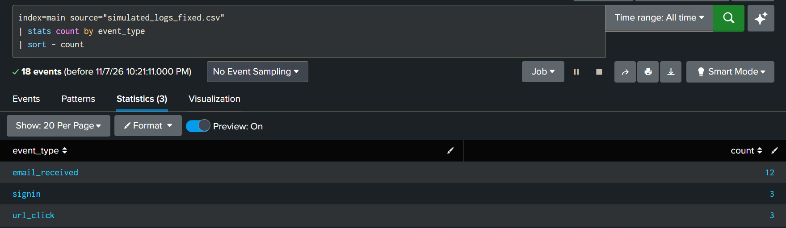

**Results:**
- `email_received`: 12 events.
- `signin`: 3 events.
- `url_click`: 3 events.
- Total: 18 events.

**Analysis:** The dataset contains 12 email delivery events, three authentication events and three recorded visits to suspicious URLs. This established the initial scope of the investigation.

### 5.2. Identification of Phishing URL Clicks

**Objective:** Identify employees who interacted with the suspicious URL and review the URLs and source IPs associated with those visits.

**Executed SPL:**

```spl
index=main source="simulated_logs_fixed.csv" event_type="url_click"
| stats count values(url) as visited_urls values(src_ip) as source_ips by user
| sort - count
```

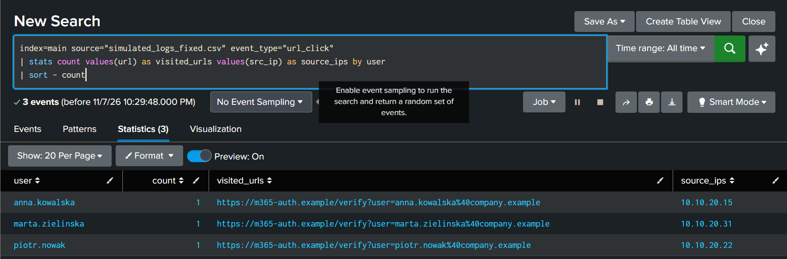

**Results:** Three employees were identified:
- `anna.kowalska` — 1 click, source IP `10.10.20.15`.
- `marta.zielinska` — 1 click, source IP `10.10.20.31`.
- `piotr.nowak` — 1 click, source IP `10.10.20.22`.

Each event contains a URL pointing to `https://m365-auth.example/verify` with a user-specific query parameter.

**Analysis:** Three out of twelve recipients interacted with the suspicious link. These employees were selected for further investigation. The logs confirm URL visits but do not establish whether credentials were submitted.

### 5.3. Sign-in Activity Review

**Objective:** Examine all authentication events and establish the normal sign-in pattern.

**Executed SPL:**

```spl
index=main source="simulated_logs_fixed.csv" event_type="signin"
| table _time user src_ip src_location device_id result mfa risk details
| sort 0 _time
```

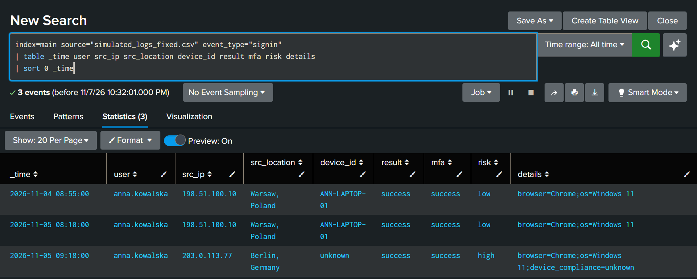

**Results:** Three authentication events were returned, all for Anna:
- 4 November 2026, 08:55 — successful sign-in from Warsaw using `ANN-LAPTOP-01`, with Low risk.
- 5 November 2026, 08:10 — successful sign-in from Warsaw using `ANN-LAPTOP-01`, with Low risk.
- 5 November 2026, 09:18 — successful sign-in from Berlin using an unknown device, with High risk.

**Analysis:** The first two authentication events established a consistent sign-in pattern. The third event represented a significant deviation and required further investigation. The search does not filter on Anna's username; Anna is the user returned in all three sign-in events in this dataset.

### 5.4. Correlation of Phishing and Authentication Events

**Objective:** Review Anna's URL click and authentication events in chronological order.

**Executed SPL:**

```spl
index=main source="simulated_logs_fixed.csv" user="anna.kowalska"
| search event_type="url_click" OR event_type="signin"
| table _time event_type user src_ip src_location device_id action result mfa risk url
| sort 0 _time
```

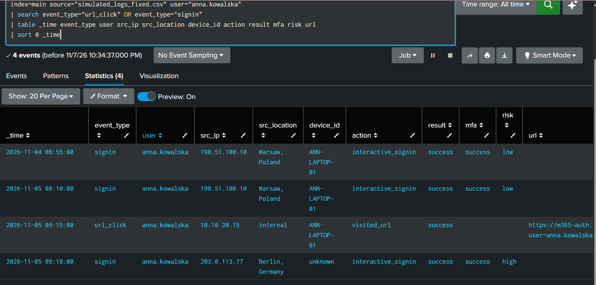

**Results:** Four events were returned:
- Two earlier successful sign-ins from Warsaw.
- A phishing URL visit at 09:15.
- A successful High-risk sign-in from Berlin at 09:18.

**Analysis:** The suspicious authentication occurred three minutes after Anna visited the phishing URL. This temporal correlation increased the priority of the investigation. Timing alone does not prove that the phishing interaction directly caused the authentication event.

### 5.5. Email Authentication Analysis

**Objective:** Investigate suspicious email authentication results and identify the characteristics of the phishing campaign.

**Executed SPL:**

```spl
index=main source="simulated_logs_fixed.csv" event_type="email_received"
| stats count values(sender) as senders values(domain) as domains values(spf) as spf values(dkim) as dkim values(dmarc) as dmarc by subject
```

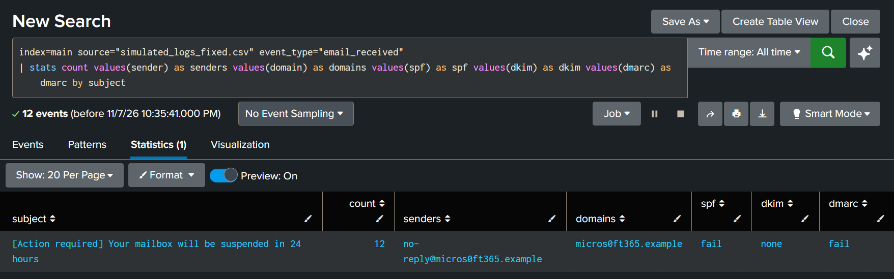

**Results:** The search returned 12 email events associated with the same subject.

Identified indicators:
- Sender: `no-reply@micros0ft365.example`
- Domain: `micros0ft365.example`
- Subject: `[Action required] Your mailbox will be suspended in 24 hours`
- SPF: `fail`
- DKIM: `none`
- DMARC: `fail`

**Analysis:** The message impersonated Microsoft 365 and used an urgent mailbox suspension warning to encourage recipients to interact with the link. The sender domain used a zero instead of the letter "o". Authentication results provided additional evidence of a suspicious message.

**Assessment:** Malicious phishing email.

### 5.6. Phishing Campaign Recipient Identification

**Objective:** Identify all recipients of the suspicious email and verify the campaign distribution scope.

**Executed SPL:**

```spl
index=main source="simulated_logs_fixed.csv" event_type="email_received"
| stats count values(sender) as sender values(src_ip) as source_ip values(domain) as domain by recipient
| sort recipient
```

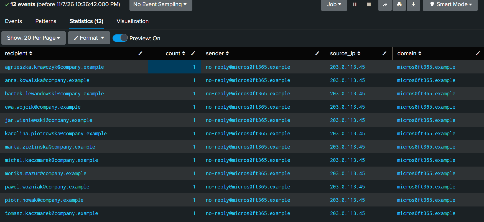

**Results:** The search returned 12 recipients. Each recipient had one recorded email delivery event.

All messages were associated with:
- The same sender: `no-reply@micros0ft365.example`
- The same source IP: `203.0.113.45`
- The same sender domain: `micros0ft365.example`

**Analysis:** The results indicate a single phishing campaign distributed to 12 employees. Grouping the email events by recipient made it possible to establish the campaign's distribution scope.

### 5.7. Recipient Impact Assessment

**Objective:** Identify which employees received the phishing email and distinguish users who clicked the suspicious link from recipients who did not.

**Executed SPL:**

```spl
index=main source="simulated_logs_fixed.csv"
(event_type="email_received" OR event_type="url_click")
| eval account=if(event_type="email_received", replace(recipient,"@company.example",""), user)
| stats count(eval(event_type="email_received")) as emails_received count(eval(event_type="url_click")) as links_clicked by account
| eval status=if(links_clicked>0,"Clicked phishing link","Received only")
| sort - links_clicked
```

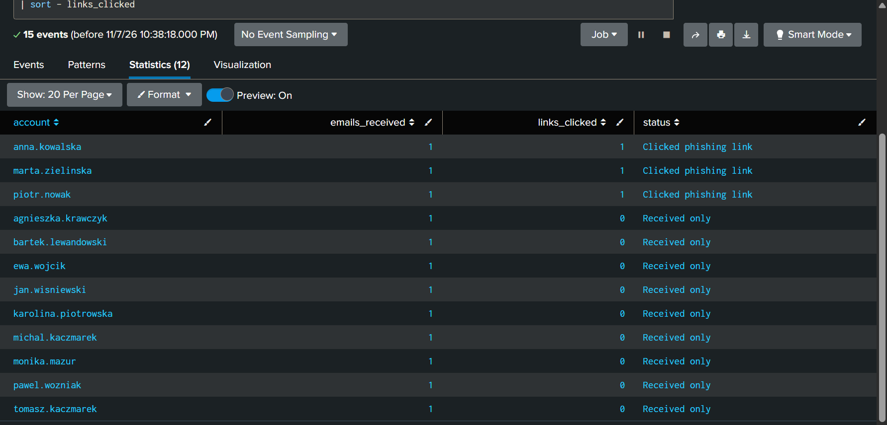

**Results:** The output contains 12 accounts:
- 12 employees received the phishing email.
- 3 employees clicked the phishing link: Anna, Marta and Piotr.
- 9 employees received the email but did not click the link.
- The click rate was 25% (3 of 12 recipients).

**Analysis:** The search correlates email delivery events with URL click events by employee account. It identifies the three employees requiring further investigation and distinguishes them from recipients who did not interact with the suspicious link.

### 5.8. Account-Level Click and Sign-in Correlation

**Objective:** Compare phishing-link clicks with sign-in activity for each account that clicked the link.

**Executed SPL:**

```spl
index=main source="simulated_logs_fixed.csv"
| eval account=if(event_type="email_received",replace(recipient,"@company.example",""),user)
| stats count(eval(event_type="url_click")) as clicks count(eval(event_type="signin")) as signins values(eval(if(event_type="signin",src_ip,null()))) as signin_ips values(eval(if(event_type="signin",risk,null()))) as risk_levels by account
| where clicks>0
```

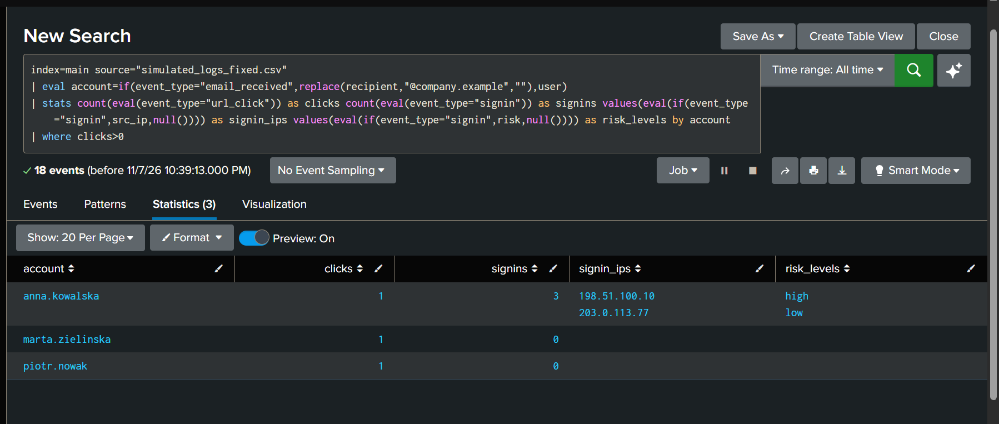

**Results:** Three accounts were returned:

| Account | Clicks | Sign-ins | Sign-in IPs | Risk levels |
|---|---:|---:|---|---|
| anna.kowalska | 1 | 3 | `198.51.100.10`, `203.0.113.77` | High, Low |
| marta.zielinska | 1 | 0 | — | — |
| piotr.nowak | 1 | 0 | — | — |

**Analysis:** All three employees who clicked the phishing URL were identified. Anna's account required additional investigation because it had three sign-in events, including the High-risk authentication from an unfamiliar IP. Marta and Piotr had no sign-in events in the supplied dataset.

### 5.9. Identification of the Suspicious Sign-in

**Objective:** Isolate the anomalous authentication event associated with Anna's account.

**Executed SPL:**

```spl
index=main source="simulated_logs_fixed.csv" user="anna.kowalska" event_type="signin"
| where risk="high" OR device_id="unknown" OR src_location="Berlin, Germany"
| table _time user src_ip src_location device_id result mfa risk details
| sort 0 _time
```

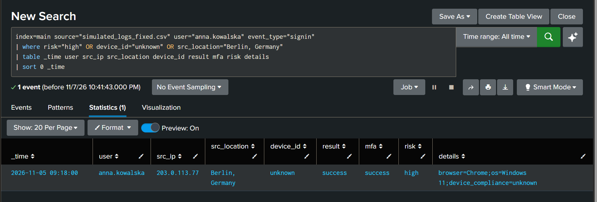

**Results:** One event matched the investigation criteria:

| Field | Observed value |
|---|---|
| Timestamp | 2026-11-05 09:18:00 |
| User | `anna.kowalska` |
| Source IP | `203.0.113.77` |
| Location | Berlin, Germany |
| Device ID | `unknown` |
| Result | `success` |
| MFA | `success` |
| Risk | `high` |
| Device compliance | `unknown` |

**Analysis:** The event differed significantly from Anna's established authentication pattern. The combination of an unfamiliar IP, unusual geographic location, unknown device and High-risk classification represents strong evidence of suspicious account activity. Anna also denied performing this authentication.

**Assessment:** High-priority suspected account compromise.

### 5.10. Reconstruction of Anna's Event Timeline

**Objective:** Review the sequence of events associated with Anna's account, including the earlier baseline sign-ins, email delivery, URL click and suspicious sign-in.

**Executed SPL:**

```spl
index=main source="simulated_logs_fixed.csv"
| eval account=if(event_type="email_received", replace(recipient,"@company.example",""), user)
| search account="anna.kowalska"
| table _time event_type account src_ip src_location device_id action result mfa risk url details
| sort 0 _time
```

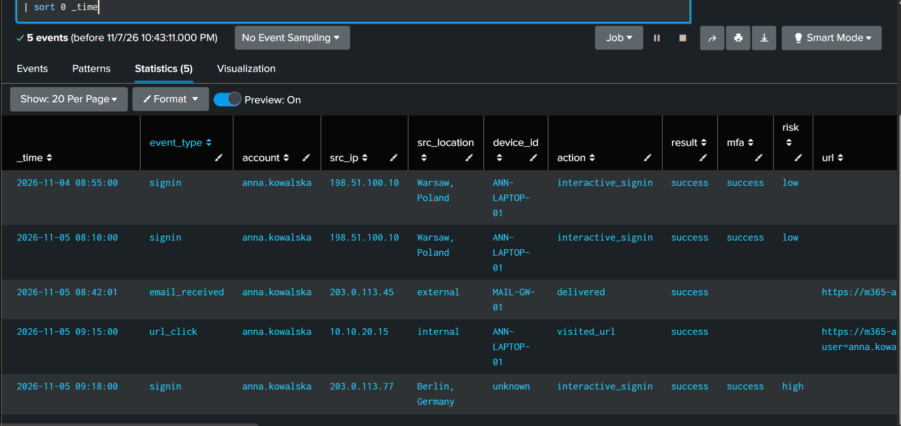

**Results:** Five events were returned:
- 4 November 2026, 08:55 — successful sign-in from Warsaw using the known device.
- 5 November 2026, 08:10 — successful sign-in from Warsaw using the known device.
- 5 November 2026, 08:42 — phishing email delivered to Anna.
- 5 November 2026, 09:15 — Anna visits the suspicious URL.
- 5 November 2026, 09:18 — successful High-risk sign-in from Berlin using an unknown device.

**Analysis:** The reconstructed timeline places the suspicious authentication three minutes after the phishing URL visit. Combined with the authentication anomalies and Anna's denial, the timeline supports treating the incident as a suspected account compromise. The temporal relationship does not prove that the phishing interaction directly caused the suspicious sign-in.

### 5.11. Post-Compromise Activity Review

**Objective:** Examine whether additional events were recorded for Anna after the suspicious authentication.

**Executed SPL:**

```spl
index=main source="simulated_logs_fixed.csv" user="anna.kowalska"
| where _time >= strptime("2026-11-05 09:18:00","%Y-%m-%d %H:%M:%S")
| table _time event_type src_ip src_location device_id action result mfa risk details
| sort 0 _time
```

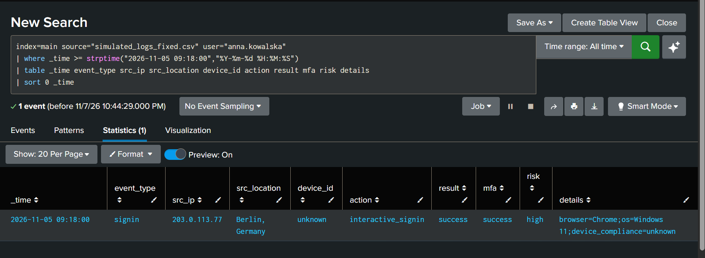

**Results:** One event was returned: the suspicious High-risk sign-in at 09:18.

No subsequent events were present in the supplied dataset.

**Analysis:** No additional post-authentication activity could be established from the available logs. This does not prove that the account was not accessed further. The dataset does not contain mailbox audit records, endpoint telemetry or detailed identity-provider session activity.

## 6. Consolidated Investigation Findings

| Finding | Result |
|---|---|
| Phishing emails delivered | 12 |
| Unique recipients | 12 |
| Employees who clicked the link | 3 |
| Employees who did not click | 9 |
| Suspicious email authentication | SPF fail, DKIM none, DMARC fail |
| Suspicious account | Anna Kowalska |
| Suspicious authentication | 5 November 2026, 09:18 |
| Geographic deviation | Warsaw → Berlin |
| Device deviation | Known device → Unknown |
| Sign-in risk | High |
| MFA result | Success |
| Time between URL click and suspicious sign-in | 3 minutes |

## 7. MITRE ATT&CK Mapping

| Technique | Name | Evidence |
|---|---|---|
| [T1566.002](https://attack.mitre.org/techniques/T1566/002/) | Spearphishing Link | Phishing email delivered to employees, followed by three recorded URL visits. |

The current evidence supports mapping the phishing delivery to T1566.002.

No additional attack technique is confirmed by the available logs. In particular, the investigation does not establish whether credentials were stolen, MFA was bypassed or a session token was compromised.

## 8. Recommended Incident Response Actions

1. **Escalate to SOC L2 / Incident Response.** Treat Anna's account as potentially compromised and preserve all relevant email, proxy and identity logs.
2. **Contain the account.** Revoke active sessions and refresh tokens, temporarily block sign-in if warranted, and reset the password through a trusted channel.
3. **Review MFA configuration.** Investigate newly registered authentication methods, unexpected MFA changes and authentication approval history.
4. **Investigate mailbox activity.** Review mailbox access, inbox rules, forwarding rules, sent messages, OAuth application consent and delegated access.
5. **Investigate endpoint activity.** Examine the affected device and available endpoint telemetry for suspicious processes, browser activity and credential theft indicators.
6. **Scope the phishing campaign.** Search all mailboxes for the sender, subject, Message-ID and URL. Quarantine or remove matching messages and contact all three employees who clicked the link.
7. **Block malicious indicators.** Block the sender and message at the email gateway and the malicious URL/domain in applicable DNS, proxy and endpoint security controls.
8. **Verify recovery.** Contact Anna through a trusted communication channel and monitor authentication activity for further anomalies.

## 9. Investigation Limitations

The dataset is synthetic and intentionally limited in scope.

It does not include:
- Phishing form submissions or credential capture records.
- Identity-provider session and token information.
- Detailed MFA prompt history.
- Endpoint detection and response telemetry.
- Mailbox audit events.
- Evidence of data access or exfiltration.

Consequently, the investigation cannot determine the exact method used to obtain access or establish what the suspicious actor accessed after authentication.

The absence of subsequent events in the supplied dataset does not prove that no further activity occurred.

The IP addresses `198.51.100.10`, `203.0.113.45` and `203.0.113.77` belong to documentation ranges reserved for examples. They must not be treated as real-world malicious indicators.

## 10. Conclusion

This investigation demonstrates an end-to-end SOC L1 workflow, including phishing email triage, SPL-based log analysis, recipient impact assessment, authentication anomaly detection, event correlation and incident escalation.

The investigation identified a phishing campaign affecting 12 employees, three recorded URL clicks and one high-priority suspected account compromise.

The strongest indicators concern Anna Kowalska's account: she visited the suspicious URL at 09:15, followed by a successful High-risk sign-in from an unfamiliar device and IP geolocated to Berlin at 09:18.

The evidence supports escalating the incident as a suspected account compromise. Further identity, endpoint and mailbox telemetry would be necessary to confirm the attack mechanism and determine the full impact of the incident.
